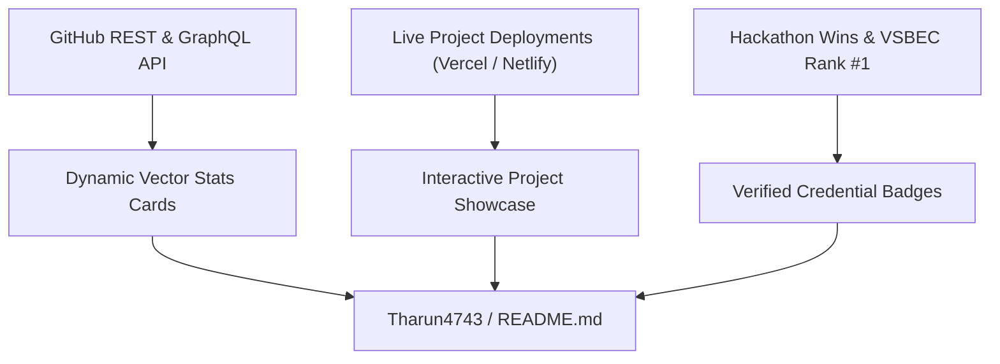

# Tharun4743 — GitHub Profile Intelligence & Engineering Telemetry Showcase

[](https://github.com/Tharun4743)
[](https://vsbec.com/)
[](https://vsbec.com/)
[](https://github.com/Tharun4743)

**Tharun4743** is the master GitHub profile repository and engineering activity portal for Tharunkumar K. It synthesizes live software engineering telemetry, verified open-source repository contributions, competitive programming milestones, hackathon accolades, and institutional achievements at V.S.B. Engineering College into an automated, high-contrast developer showcase.

---

## Problem Statement & Context
Developer profiles frequently fail to accurately convey practical engineering proficiency:
- **Static Resumes**: Traditional PDF resumes quickly become outdated and fail to show daily coding cadence, commit streaks, and real-time repo activity.
- **Fragmented Portfolios**: Recruiters must independently search for a developer's GitHub, LeetCode, hackathon wins, and live deployments across separate sites.
- **Lack of Institutional Context**: Exceptional academic performance and institutional leadership often lack verified digital visibility.

---

## Existing Solutions & Critical Gaps
| Developer Profile Type | Telemetry Real-Time Status | Verifiable Code Links | Institutional Accolades |
| :--- | :--- | :--- | :--- |
| **Static Text Resume** | Outdated the moment it is printed | No direct code links | Often unverified |
| **Tharun4743 Showcase** | **Live dynamic SVG badges & commit analytics** | **Direct links to 30+ public repositories** | **Rank #1 GitHub profile at VSBEC** |

---

## Proposed Solution & Architectural Innovation
The profile repository implements a **Live Developer Telemetry Hub**:
- **Dynamic Badge Orchestration**: Integrates real-time GitHub stats, language breakdowns, and commit frequency widgets.
- **Flagship Project Deep Dives**: Prominently features top architectural achievements: VSBEC IT Vault (TaskManager), AURA local multimodal RAG, and Smart Helmet IoT.
- **Competitive Programming Verification**: Direct links and verified stats from LeetCode, Codeforces, and national hackathons (SIH, CODE THUGS 2K26).
- **Semantic Schema Metadata**: Includes structured `schema.org/Person` metadata for optimal recruiter discovery and web indexing.

---

## Technical Approach & System Architecture


---

## Quantifiable Impact & Measurable Benefits
- **Rank #1 GitHub Profile at VSBEC**: Recognized across V.S.B. Engineering College as the top developer profile.
- **Comprehensive Transparency**: Offers recruiters complete visibility into 30+ public repositories and daily commit consistency.
- **High-Contrast Clean Aesthetic**: Linear/Raycast-inspired design optimized for instant readability.

---

## Feasibility, Operational Viability & Scalability
- **Zero Maintenance**: GitHub Actions automatically refresh dynamic cards and metrics.

---

## Project Architecture & Quickstart
```bash
# View live on GitHub:
# https://github.com/Tharun4743
```

---

## Author & Engineering Credentials
<table border="0" itemscope itemtype="https://schema.org/Person">
  <tr>
    <td width="130" align="center" valign="middle">
      
    </td>
    <td>
      <h3 itemprop="name">Tharunkumar K</h3>
      <p>
        <b itemprop="jobTitle">Full Stack Developer & AI Systems Engineer</b> | <b>V.S.B. Engineering College (VSBEC)</b><br/>
        🎓 <b>B.Tech in Information Technology</b> — <b>V.S.B. Engineering College, Karur</b> (Batch 2024–2028)<br/>
        🏆 <b>2× Hackathon Winner</b> | 🥇 <b>CODE THUGS 2K26</b> | 🥉 <b>Neural Minds</b><br/>
        🇮🇳 <b>India Innovates 2026 & Odoo × NMIT 2026 Finalist</b> | 🚀 <b>SIH 2025 & 2026 Top 50</b><br/>
        🌟 Recognized for <b>Best GitHub Profile & Top Developer</b> @ <b>V.S.B. ENGINEERING COLLEGE</b>
      </p>
      <p>
        🚀 <b>Top Flagship Engineering Projects:</b><br/>
        • 🏛️ <b>TaskManager (VSBEC IT Vault)</b> — Institutional Task Governance & LeetCode/GitHub Sync &nbsp;<a href="https://github.com/Tharun4743/Taskmanager"></a>&nbsp;<a href="https://it-taskmanager.vercel.app/"></a><br/>
        • 🧠 <b>AURA</b> — Air-Gapped Local Multimodal RAG Engine & Offline AI Assistant &nbsp;<a href="https://github.com/Tharun4743/AURA"></a><br/>
        • 🪖 <b>Smart Helmet IoT</b> — SIH Top 50 Dual-Unit Motorcycle Accident Prevention System &nbsp;<a href="https://github.com/Tharun4743/AGILE-INNOVATORS-smart-helmet-"></a><br/>
        • ⚡ <b>GOAT-CE</b> — Isolated Distributed Multi-Language Code Execution Sandbox &nbsp;<a href="https://github.com/Tharun4743/GOAT-CE"></a>
      </p>
      <p>
        <a href="https://tharunkumark4743.netlify.app/"></a>&nbsp;
        <a href="https://github.com/Tharun4743"></a>&nbsp;
        <a href="https://www.linkedin.com/in/tharunkumark4743"></a>&nbsp;
        <a href="https://leetcode.com/u/Tharunkumar__K/"></a>&nbsp;
        <a href="mailto:tharunkumark42007@gmail.com"></a>
      </p>
    </td>
  </tr>
</table>
