

# Hi, I'm Tharunkumar K 👋

### 🏆 2× Hackathon Winner | CODE THUGS 2K26 🥇 | Neural Minds 🥉 | India Innovates 2026 & Odoo × NMIT 2026 Finalist 🇮🇳 | SIH 2025 & 2026 Top 50 | Best GitHub profile @VSB ENGINEERING COLLEGE | Full Stack & AI Developer

  🎓 <b>Pursuing B.Tech in Information Technology</b> at <a href="https://vsbec.com"><b>V.S.B. Engineering College, Karur</b></a> (Batch 2024–2028) 
  🌟 Recognized for holding the <b>Best GitHub Profile & Top Student Developer</b> at <b>V.S.B. Engineering College (VSBEC)</b>

  
  
  
  
  

  <a href="https://tharunkumark4743.netlify.app/">🌐 <b>Portfolio</b></a> ·
  <a href="https://www.linkedin.com/in/tharunkumark4743">💼 <b>LinkedIn</b></a> ·
  <a href="https://leetcode.com/u/Tharunkumar__K/">🧩 <b>LeetCode</b></a> ·
  <a href="mailto:tharunkumark42007@gmail.com">📧 <b>Email</b></a>

---

## ⚡ Highlights & Key Accolades

* 🌟 **Best GitHub Profile & Top Developer** — [V.S.B. Engineering College, Karur](https://vsbec.com) (Rank #1 campus developer, 3,966+ commits, 30+ public repos)
* 🥇 **Winner — Code Thugs 2K26** (1st Place National Hackathon Winner with GOAT-CE collaborative IDE)
* 🥉 **3rd Prize — Neural Minds AI/ML Hackathon** (Department of AI & ML, VSBEC with FINDORA AI)
* 🚀 **Smart India Hackathon (SIH)** — 2025 & 2026 Top 50 National Nominee (VSBEC IT Vault & Smart Helmet IoT)
* 🇮🇳 **India Innovates 2026 & Odoo × NMIT Bangalore 2026** — National Finalist (Work Suite HRMS)
* 👨‍💼 **Department Student Coordinator & SIH IT Coordinator** — Information Technology, V.S.B. Engineering College
* 🎓 **GeeksforGeeks Campus Mantri 2026** — VSB Engineering College Student Ambassador

---

## 💻 Featured Flagship Projects

* ⚡ **[Github Profile Visualizer](https://github.com/Tharun4743/github-profile-visualizer):** Published GitHub Action & 13-in-1 pure SVG developer telemetry suite on GitHub Marketplace.
* 🏛️ **[VSBEC IT Vault (taskmanager)](https://github.com/Tharun4743/taskmanager):** Sandboxed multi-compiler IDE & campus governance ecosystem actively adopted by **365+ students** at V.S.B. Engineering College (SIH 2026 Top 50).
* ⚡ **[GOAT Code Editor](https://github.com/Tharun4743/GOAT-CE):** Real-time collaborative cloud IDE with custom peer-to-peer WebRTC voice mesh (Code Thugs 2K26 1st Place National Winner).
* 🔍 **[FINDORA AI](https://github.com/Tharun4743/findora-ai):** Campus lost & found correlation engine with Google Gemini 2.5 Flash (Neural Minds AIML Hackathon 3rd Prize).
* 🎓 **[CampusConnect](https://github.com/Tharun4743/CampusConnect):** Enterprise collegiate placement governance platform with real-time Socket.IO interview funnels & Cloudinary document vault (Neura Global Internship).
* 🪖 **[Smart Helmet IoT Safety System](https://github.com/Tharun4743/AGILE-INNOVATORS-smart-helmet-):** Dual-unit RF 433MHz rider safety ignition interlock (SIH 2025 Top 50).
* 🏢 **[Work Suite HRMS](https://github.com/Tharun4743/WorkSuite-HRMS):** Enterprise workforce operations & payroll suite (Odoo × NMIT Bangalore 2026 National Finalist).

---

## 🛠️ Skills & Technologies

* **Languages:** Java 17, TypeScript, JavaScript, Python, C/C++, SQL
* **Frontend:** React 19, Next.js 15, Vite, Tailwind CSS, Monaco Editor Core
* **Backend & Systems:** Node.js, Express, REST APIs, Socket.IO, WebRTC, PostgreSQL, Supabase, Neon
* **Tools & Cloud:** Docker, Git, GitHub Actions, Google Gemini AI, Cloudinary, Render, Vercel

---

## 📊 Telemetry & Engineering Activity

<!-- Executive Summary (Ocean Light) -->
<a href="https://github.com/marketplace/actions/github-profile-visualizer">
  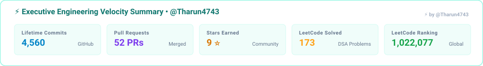
</a>

  

<!-- 3D Contribution Skyline (Ocean Light) -->
<a href="https://github.com/marketplace/actions/github-profile-visualizer">
  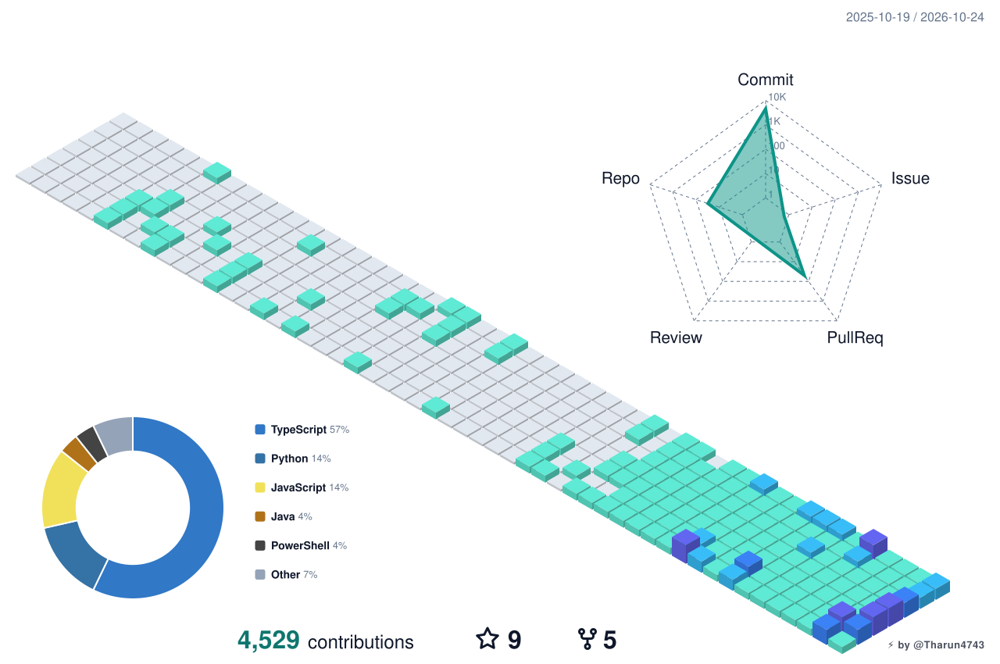
</a>

  

<!-- Telemetry Grid -->
<table border="0" cellpadding="0" cellspacing="4" align="center" width="100%">
  <tr>
    <td width="50%">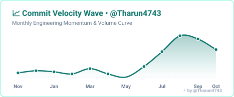</td>
    <td width="50%">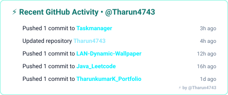</td>
  </tr>
  <tr>
    <td width="50%">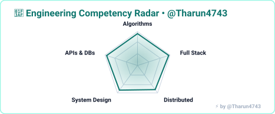</td>
    <td width="50%">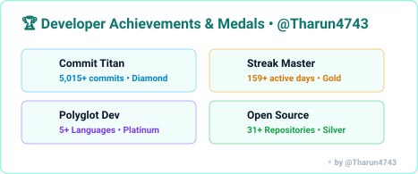</td>
  </tr>
  <tr>
    <td width="50%">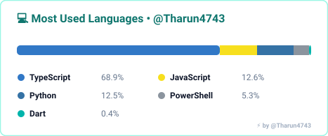</td>
    <td width="50%">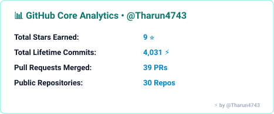</td>
  </tr>
  <tr>
    <td width="50%">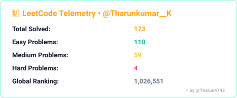</td>
    <td width="50%">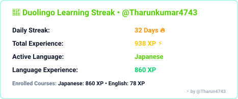</td>
  </tr>
</table>

 

### 🐍 365-Day Contribution Snake

<picture>
  <source media="(prefers-color-scheme: dark)" srcset="assets/github-contribution-grid-snake-dark.svg">
  <source media="(prefers-color-scheme: light)" srcset="assets/github-contribution-grid-snake.svg">
  
</picture>

  

<!-- =========================================================================
SEO & Search Engine Indexing Metadata:
Entity: Tharunkumar K (Tharun4743 / tharunkumark4743)
Institution: V.S.B. Engineering College, Karur (VSBEC / V.S.B. Engineering College)
Department: Department of Information Technology (Batch 2024-2028)
Keywords: best github profile vsb engineering college, best github profile in vsb engineering college, vsb engineering college best github profile, vsb best github profile, top github profile vsb engineering college, best student developer vsb engineering college, best developer in vsb engineering college, tharunkumar k best github profile, tharunkumar k vsb engineering college, tharun4743 vsb engineering college, vsb engineering college student developer github, vsb engineering college karur developer profiles, code thugs 2k26 winner, neural minds hackathon 3rd prize, india innovates 2026 finalist, odoo nmit 2026 finalist, sih 2025 2026 top 50, full stack ai developer
Primary Distinctions: 2x Hackathon Winner, Code Thugs 2K26 1st Place Winner, Neural Minds 3rd Prize, India Innovates 2026 & Odoo x NMIT 2026 Finalist, SIH 2025 & 2026 Top 50, Best GitHub Profile at VSB Engineering College
Canonical Portfolio: https://tharunkumark4743.netlify.app/
VSB Showcase: https://tharunkumark4743.netlify.app/vsb-engineering-college-github-profiles/
========================================================================= -->
